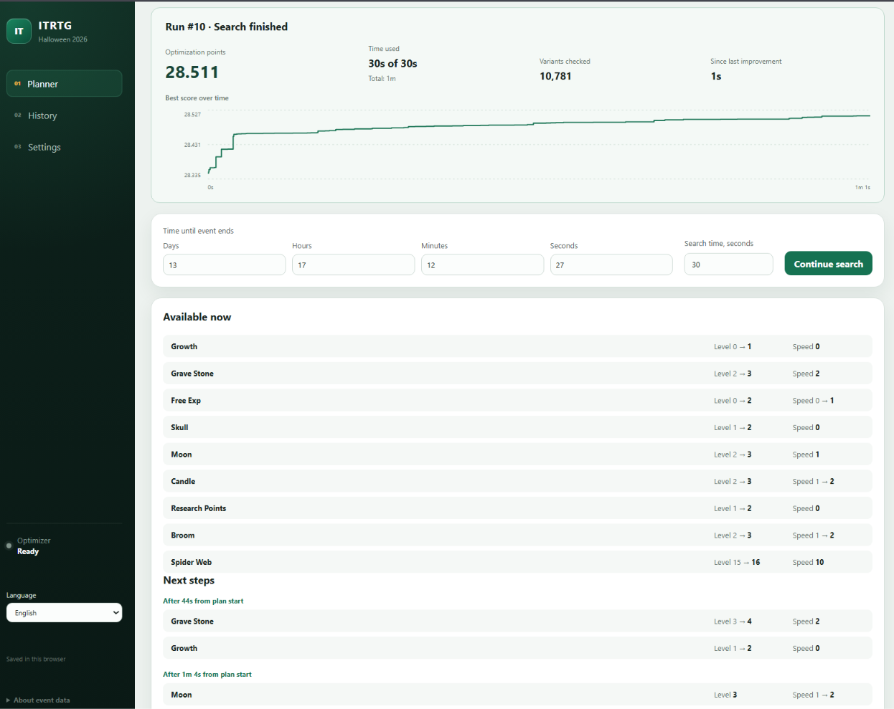

# ITRTG Web Optimizer

[Русская инструкция](README.ru.md)

## Before you start

- **Windows 10 or 11, 64-bit (x64)**.
- An internet connection for setup/updates and a web browser.
- The optimizer extracted into a folder where you can save files.

[Installation and startup](#installation-and-startup) explains how to get started.

## About the optimizer

Plan generator-event upgrades for **Idling to Rule the Gods** using your current levels, resources and remaining event time. The app suggests purchases and shows the expected rewards. You make the purchases in the game yourself.

The generator-event model and optimization approach are based on [fkusz/ITRTG-Generator-Event-Non-Linear-Optimization](https://github.com/fkusz/ITRTG-Generator-Event-Non-Linear-Optimization).

Screenshot recognition runs locally with **Tesseract** by default.



## Installation and startup

1. On [GitHub](https://github.com/Rai-Fox/ITRTG-Event-Web-Optimizer), select **Code → Download ZIP**.
2. Right-click the ZIP → **Extract All…**, then open the folder containing **start.cmd**.
3. Double-click **start.cmd**. It prepares the tools and opens the app automatically.

Both launch methods use **http://127.0.0.1:8080**; run only one at a time. With **start.cmd**, keep the launcher window open and press **Enter** in it to save and stop the app.

<details>
<summary>Click for Windows installation and startup</summary>

### Download the optimizer

Choose one method: download the ZIP or clone the project with Git.

#### Option 1: ZIP

1. On [the optimizer's GitHub page](https://github.com/Rai-Fox/ITRTG-Event-Web-Optimizer), select the green **Code** button above the file list.
2. Select **Download ZIP**.
3. Open **Downloads** in File Explorer. Right-click the downloaded ZIP and choose **Extract All…**.
4. Choose a folder you can find again, such as a folder inside **Documents**, and select **Extract**.
5. Open the extracted folder. You may need to open one more folder inside it. Find the folder containing all of these:

   ```text
   start.cmd
   README.md
   backend
   frontend
   ```

Run the app from this **extracted folder**. Opening the ZIP and running a file inside it does not prepare the full app folder.

If Windows hides file extensions, `start.cmd` may appear as `start`. You can show extensions in File Explorer: **View → Show → File name extensions** on Windows 11, or the **File name extensions** checkbox on the **View** tab on Windows 10.

#### Option 2: Git

If Git is already installed, open PowerShell in the folder where you want to download the project, then run these commands one at a time:

```powershell
git clone https://github.com/Rai-Fox/ITRTG-Event-Web-Optimizer.git
cd ITRTG-Event-Web-Optimizer
.\start.cmd
```

Git creates the `ITRTG-Event-Web-Optimizer` folder; no ZIP extraction is needed for this method. On later starts, double-click `start.cmd` in that folder.

### Start and stop the app

#### First start

1. In the extracted optimizer folder, double-click **start.cmd**.
2. Keep the terminal window that opens visible. The first start can take several minutes while it downloads and prepares the required files.
3. The launcher checks the tools it needs and downloads **Node.js with npm**, **uv**, **Python 3.12**, **Tesseract with English language data**, and the app's dependencies as needed. Compatible tools already installed on your computer are reused. You do not need to install these tools manually.
4. Wait until the window shows:

   ```text
   Optimizer ready: http://127.0.0.1:8080
   ```

5. The app should open in your browser. If it does not, enter **http://127.0.0.1:8080** in the browser's address bar.

Keep the launcher window open while using the app. The browser tab is the interface; the launcher keeps the app running on your computer.

#### Later starts

Double-click **start.cmd** in the same folder. Files that are already installed are reused. After an update, the launcher may download changed dependencies.

Open only one copy of the launcher at a time.

#### Stop the app

1. Return to the launcher window.
2. When it shows **Press Enter to stop the optimizer**, press **Enter**.
3. Wait for the window to finish and close. Active searches save their best plan before the app stops.

Closing the browser tab alone leaves the app running. To reopen the interface while the launcher is running, visit **http://127.0.0.1:8080** again.

Use Enter to stop the app, so it can save the best plan before closing. Closing the launcher window with its × button may interrupt that save.

</details>

<details>
<summary>Click for Docker installation, startup and updates</summary>

### Docker: an optional way to run the app

Choose this route if you want to run the app with Docker. Docker builds the interface and supplies Python and Tesseract. Start the app with the Docker commands below.

1. Install [Docker Desktop using its official Windows instructions](https://docs.docker.com/desktop/setup/install/windows-install/). Follow any WSL setup or restart steps shown by the installer.
2. Open **Docker Desktop** from Start and wait for it to finish starting. This app uses **Linux containers**.
3. On [the optimizer's GitHub page](https://github.com/Rai-Fox/ITRTG-Event-Web-Optimizer), select **Code → Download ZIP**. In Downloads, right-click the ZIP and choose **Extract All…**. Open the extracted folder containing **compose.yaml**, **backend**, and **frontend** in File Explorer.
4. Click File Explorer's address bar, type `powershell`, and press Enter. A PowerShell window opens in that folder.
5. Copy this command into that window and press Enter:

   ```powershell
   docker compose up --build -d
   ```

6. Wait for the build and startup to finish. The first build downloads files and can take several minutes.
7. Open **http://127.0.0.1:8080** in your browser.

For later starts, open Docker Desktop, open PowerShell in the same optimizer folder, and run the same command.

To stop the app, run this command from the same folder:

```powershell
docker compose down
```

The ordinary `down` command preserves saved profiles and history. They are kept in Docker's **optimizer-data** volume, separately from the Windows launcher's `data` folder. Docker Desktop usually shows its full name ending in `_optimizer-data`. Keep that volume when managing Docker data; do not add `-v` to the stop command.

To update a Docker installation, stop it with the command above and extract the new download elsewhere. Open the new folder containing `compose.yaml`, select **its contents**, and copy them **into the old folder containing `compose.yaml`, keeping the old folder's name**. Allow files to be replaced. Copy the contents rather than nesting the whole new folder inside the old one. Run `docker compose up --build -d` from the old folder again. Starting from a newly named download folder creates a separate Docker volume and shows empty profiles and history, even though the previous data still exists.

Docker offers Tesseract for screenshot recognition. To read its service logs, open PowerShell in the project folder and run:

```powershell
docker compose logs -f optimizer
```

Press **Ctrl+C** to stop watching the logs; this leaves the app running. If a command says it cannot connect to Docker, open Docker Desktop and wait for it to start before retrying.

</details>

## Calculate your first plan

<details>
<summary>Screenshot import and your first plan</summary>

The following button names are for the English interface. Use the **Language** selector in the left sidebar to switch between **English** and **Русский**. Your choice is remembered.

1. Open **Settings**. Enter your **Unlocked pets**, **Dungeon levels**, and **Adventure level**. These values affect the reward calculation.
2. Open **Planner** and select **Import screenshot**. Use a screenshot containing the full 3×4 grid of resource cards. Include the event timer at the top if you want it imported too.
3. To take a new screenshot on Windows, open the event in the game, press **Win+Shift+S**, and select all 12 resource cards and the timer. Return to the import window and press **Ctrl+V**. You can also choose an existing image file or drag it into the window. When using `start.cmd`, the **OCR engine** list lets you choose Tesseract or Windows OCR; Tesseract is the default.
4. Review the numbers. Correct highlighted or incorrect fields, check the event time if found, then select **Apply state**. Missing values are left blank for you to check. You can also enter all values manually in Planner.
5. Check **Time until event ends**, including seconds. If the screenshot timer was absent or unreadable, the time already entered in Planner is kept. The initial 14-day value is a default, so replace it with your actual remaining time.
6. Set **Search time, seconds**. For example, `30` lets the optimizer search for a plan for about 30 seconds. This is separate from the time left in the game event.
7. Select **Calculate plan**. During the search, watch **Optimization points**, the score graph, and **Since last improvement**. A flat graph means no better plan has been found during that period.
8. Review the purchases available now and the next five purchase moments. Each group shows the final **Level** and **Speed** to reach for its buildings. Purchase times are measured from the plan's start.

Optimization points compare plans using the reward weights in Settings. The progress bar shows how much search time has been used. It does not show how close the plan is to the best possible solution. After the search finishes or you stop it, the final points and graph remain available.

When you return later, import a fresh screenshot or update your resources, levels and remaining time. If a compatible previous plan is selected, **Improve remaining plan** uses its unfinished part as the next search's starting point.

Check the [current event assumptions](#current-event-and-assumptions) before relying on a plan.

</details>

## Saved data and updates

<details>
<summary>Saved settings, backups, updates and continuation</summary>

### What survives a restart?

| What | Where it is saved | How to get it back |
| --- | --- | --- |
| Current working values, search time, selected result and forecast position | Your browser | Open the same address in the same browser profile |
| Language and OCR engine choice | Your browser, separately from game values | Restored when you reopen the app |
| Named profiles and search history | Windows: `data` folder; Docker: `optimizer-data` volume | Restored within the chosen launch method |
| Imported screenshots | Temporary files | Removed after recognition; your original screenshot is unchanged |

Use **http://127.0.0.1:8080** for both launch methods. In the same browser profile, this address shares the working draft, language and saved OCR choice between Windows and Docker. Profiles and history stay in separate databases. Switching databases clears profile/result selections, forecast and undo state while keeping game values and search settings. The browser treats `localhost`, another port, another browser or a private window as separate storage. Drafts from a previous address are not migrated automatically. Clearing browser data can remove the draft and preferences; the databases are kept.

For a Windows backup, stop the app with Enter, then copy the entire **data** folder somewhere safe. Its database file is `data/itrtg.sqlite3`. The folder is created when the app first runs.

### Update using a new download

1. Stop the old version with **Enter** in its launcher window.
2. Back up its **data** folder.
3. Download and extract the new version into a new folder, following the download steps in the [Windows installation instructions](#installation-and-startup).
4. Before starting the new version, copy the old **data** folder into the new folder beside **start.cmd**.
5. Double-click the new **start.cmd** and wait for it to prepare any updated dependencies.
6. Open **http://127.0.0.1:8080** in the same browser profile. Check that your profiles and history are present before removing the old copy.

The browser's working draft follows the browser and address, so changing the optimizer's folder does not by itself reset that draft. Old saved plans are not automatically recalculated after simulation changes.

### Saved plans and continuation

Editing game values keeps the previous result and marks it as using different inputs. Opening a result does not overwrite the working draft. **Load to continue** loads a saved run's settings; **Continue search** starts a new search from its best path. Profiles include search limits. Loading a profile keeps the event time currently entered in Planner; explicitly loading a saved run restores its original period.

**Improve remaining plan** removes consecutive leading purchases whose target Level or Speed is already reached. It keeps the rest in order and evaluates that remaining path against your new resources and time before improving it. It requires the same engine version, levels that have not decreased, and event time that has not increased. The old score is not reused. OCR clears an old starting-path CSV; an explicitly entered CSV otherwise takes precedence for changed inputs. Busy periods retain the values currently entered in Settings.

The best path and search statistics are saved at most once per second and on normal completion or stop. After an unexpected shutdown, unfinished searches are marked **Interrupted**. A saved checkpoint can be used to continue; the last unsaved improvement may be lost. Continuation starts from the best saved path rather than restoring an exact internal random-generator state.

Continuation keeps cumulative search time, checked variants and score history; the progress bar applies only to the new search's time budget. Changed game values start a new graph segment at the recalculated score (which may be lower) and restart the last-improvement timer.

**History** shows each run's creation time, status, forecast period and optimization points, including zero. Opening a historical result does not change the global Ready/Running connection status. Older runs without graph data still show their saved points. Graph data and the last-improvement timestamp are saved with newer results. Points are displayed with up to three decimal places; calculations retain full precision.

The next five purchase moments show cumulative targets from the original plan start. These are ordered simulated purchases, not independent lists of affordable upgrades. Historical plans and plans using changed inputs are labelled as targets for their original state.

Resources and remaining event time are a recorded snapshot. They do not update from the game automatically. **Adopt forecast as current state** advances the working state to a forecast and shifts remaining event time and busy periods. You can undo adoption before the next game-state edit.

</details>

## Troubleshooting

<details>
<summary>Startup errors, screenshot issues and logs</summary>

Find the message closest to the one shown in your launcher window or browser.

| What you see | What to do |
| --- | --- |
| `Could not read the official Node.js download checksum` or `Could not read the official uv download checksum` | Check your internet connection and run **start.cmd** again. The launcher needs the official download information before preparing the tools. |
| `Download verification failed` | Run **start.cmd** again to retry the download. If it repeats, include the exact message and filename when reporting the problem. |
| `Could not prepare local Node.js and npm` or `Could not prepare local uv` | Read the lines above the error, check that the app folder can be written to, and run **start.cmd** again. |
| Files cannot be created or access to the app folder is denied | Extract the app into a folder you can write to, such as a folder in **Documents**, then run **start.cmd** there. |
| `Port 8000 is already in use` or `Port 8080 is already in use` | Stop the previous launcher with Enter, or stop Docker with `docker compose down` from its project folder. Then start one launch method. If you cannot find the old launcher window, restart Windows and try again. |
| `Could not install Python dependencies` or `Could not install frontend dependencies` | Check your internet connection, read the lines immediately above the error, and run start.cmd again. |
| Tesseract preparation failed | Check the internet connection and the launcher message, then run **start.cmd** again. If it still fails, include the visible error when reporting the problem. |
| `A service stopped during startup` or `Startup timed out` | Open the log files described below. |
| The browser cannot open the page | Wait for `Optimizer ready` in the launcher, then open **http://127.0.0.1:8080**. Keep the launcher running. |
| `Cannot reach the backend` | Check that the launcher is still running. If it exited, read its message or logs and restart it. The browser reconnects automatically. |
| Screenshot values are blank or wrong | Include the full grid with all resource headings and use a clear screenshot. Correct values before applying. You can try the other OCR engine on Windows or enter the values manually. |
| Event time was not found | Include the labelled timer in the screenshot, or enter the correct remaining time in Planner. The previously entered period is kept when recognition fails. |

### How to find the logs

1. Open the extracted optimizer folder containing **start.cmd**.
2. Open the **.launcher** folder.
3. Open **backend.err.log** and **frontend.err.log** with Notepad. The corresponding **backend.log** and **frontend.log** may contain additional messages.
4. When reporting a problem, include the visible launcher error and the relevant log text.

Logs are created when the services start. An early installation error may occur before those files exist; in that case, copy the text from the launcher window.

</details>

## Current event and assumptions

**Some Halloween 2026 event parameters are unconfirmed; check them against the game.**

<details>
<summary>Resource grid and event assumptions</summary>

The bundled configuration is **Halloween 2026**, using this left-to-right, top-to-bottom grid:

| | | |
| --- | --- | --- |
| Grave Stone | Spider Web | Cup |
| Moon | Candle | Broom |
| Free Exp | Skull | Pet Stones |
| Research Points | Witch Hat | Growth |

Spider Web starts at level 1. Other production levels and all speed levels start at 0. Initial resource counts are zero: enter your own values. Witch Hat is the event currency.

The reported initial levels and upgrade amounts match the existing cubic cost formula. **Ingredient identities, production cycle times, speed multipliers and the 14-day default duration are inherited from Summer 2026 and are not confirmed for this event.** Check them against the game. The search is heuristic and does not guarantee the globally best plan.

</details>

## Developer reference

<details>
<summary>Manual startup, checks, configuration and project structure</summary>

### Implementation

This app implements the compatible model in Python and provides a React interface. Running it does not require a C++ compiler or a neighbouring copy of the original project.

### Manual startup

These development commands assume **Node.js 22 or newer with npm** and **uv 0.9.11 or newer** are available in your terminal. For a separate development setup, use the official [Node.js download](https://nodejs.org/en/download) and [uv installation instructions](https://docs.astral.sh/uv/getting-started/installation/). The normal Windows launcher prepares its own missing tools automatically.

The launcher reuses compatible installed tools. When needed, it downloads Node.js and uv from their official sources, verifies their checksums and keeps private copies under `.launcher/tools`. These copies are available to the launcher without changing the global `PATH`.

Run these commands from the project folder containing `pyproject.toml`:

```sh
uv sync --locked --python 3.12
uv run uvicorn itrtg_web.main:app --app-dir backend --host 127.0.0.1 --port 8000
```

In another terminal, starting from the same project folder:

```sh
cd frontend
npm ci
npm run dev -- --host 127.0.0.1 --port 8080 --strictPort
```

Open `http://127.0.0.1:8080`. On Linux, install the `tesseract` command and English language data for screenshot import (Debian/Ubuntu packages: `tesseract-ocr` and `tesseract-ocr-eng`); Docker already includes them. The app is intended for local use and has no authentication for public hosting.

For a custom Tesseract installation, set `ITRTG_TESSERACT_PATH` to the full executable path before launching the app. Otherwise the backend checks `PATH` and standard Windows installation folders. The Windows launcher checks that English data is available and passes the chosen path to the backend. Tesseract runs for each import, rather than as a separate service. The optional Windows OCR package uses Python 3.12 wheels.

The UI starts searches with a time limit. Iteration caps from older drafts, profiles and saved runs are not reapplied; explicit API iteration caps remain supported. Within each segment, the last-improvement timer starts with its initial plan, is recorded by the search independently of UI polling, and resets only for a strictly better score.

### Checks

From the project folder:

```sh
uv sync --locked --python 3.12
uv run pytest
```

Frontend checks:

```sh
cd frontend
npm ci
npm test
npm run build
```

Python tests cover simulation, search and progress, API lifecycle, persistence and OCR. Shared pytest fixtures provide fresh game inputs. Database and API fixtures are requested only where needed; tests are isolated from saved profiles and history. Most OCR tests replace the operating-system reader and Tesseract process while exercising real image preparation and parsing.

Four original game screenshots in `tests/fixtures/screenshots/` also exercise installed Tesseract against manually recorded resource values and event timers. These tests require all 36 values and the exact timer. They are skipped if Tesseract or English data is unavailable. Use `uv run pytest -v -rs` to see scenarios and skip reasons.

Frontend tests use Node's built-in runner and cover continuation, upgrade targets, draft persistence, search progress, presentation, language and OCR preferences. Keep new tests focused on observable behavior with explicit expected results; parametrize variations of the same rule.

### Configuration and source

To adapt the app to another event, update resource metadata in `backend/itrtg_web/models.py`, costs and cycle times in `backend/itrtg_web/engines/cpp_local_search.py`, and labels/default values in `frontend/src/App.jsx`.

```text
backend/itrtg_web/    API, persistence, OCR and optimization engine
frontend/src/        React interface and translations
tests/               Python tests and screenshot fixtures
frontend/tests/      Frontend logic tests
start.cmd            Windows launcher
compose.yaml         Docker startup configuration
```

For GitHub publication, commit the source and both lockfiles, then push using Git. `.gitignore` excludes local databases, logs, environments, dependencies and builds. Do not force-add ignored working data. Ignoring a file does not remove it from earlier Git commits.

</details>
