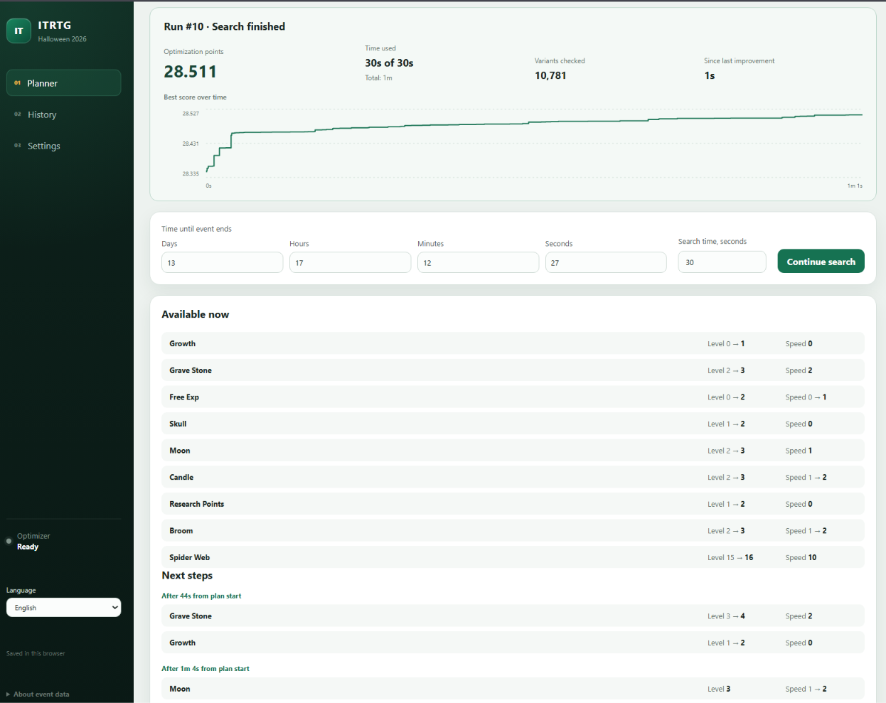

# ITRTG Web Optimizer

[English instructions](README.md)

## Перед запуском

- Для `start.cmd`: **Windows 10/11, 64 бит (x64)**.
- **Интернет** для первой подготовки и обновлений, обычный **веб-браузер**.
- Папка проекта, в которой можно сохранять файлы.

Node.js, uv, Python и Tesseract подготовит `start.cmd`. **[Как установить и запустить](#установка-и-запуск)**.

## Об оптимизаторе

Планировщик улучшений генераторов для **Idling to Rule the Gods**, созданный на основе [fkusz/ITRTG-Generator-Event-Non-Linear-Optimization](https://github.com/fkusz/ITRTG-Generator-Event-Non-Linear-Optimization).

Загрузите игровой скриншот или внесите ресурсы вручную — оптимизатор предложит порядок покупок, целевые уровни и скорости. Он показывает график улучшений, сохраняет результаты и может продолжить прежний план. Покупки в игре вы выполняете сами.

Расчёты и распознавание через Tesseract выполняются локально. Интерфейс доступен на русском и английском.



## Установка и запуск

1. На [странице проекта](https://github.com/Rai-Fox/ITRTG-Event-Web-Optimizer) нажмите **Code → Download ZIP**.
2. Нажмите по ZIP правой кнопкой → **Извлечь всё…** и откройте папку с `start.cmd`.
3. Дважды щёлкните по **`start.cmd`** и дождитесь браузера: **http://127.0.0.1:8080**.

Адрес общий для Windows и Docker; запускайте только один способ одновременно. При использовании `start.cmd` оставьте окно открытым, для завершения нажмите в нём **Enter**. Первый запуск может занять несколько минут.

В боковой панели приложения выберите **Русский**. Откройте **Настройки**, внесите игровые параметры, затем в **Планировщике** импортируйте скриншот и нажмите **Рассчитать план**.

<details>
<summary>Windows: установка, первый запуск и завершение работы</summary>

### Скачайте оптимизатор

Выберите один способ: скачать ZIP или клонировать проект через Git.

#### Вариант 1: ZIP

1. На [странице проекта в GitHub](https://github.com/Rai-Fox/ITRTG-Event-Web-Optimizer) нажмите зелёную кнопку **Code** над списком файлов.
2. Выберите **Download ZIP**. Для этого Git и регистрация в GitHub не нужны.
3. Найдите скачанный ZIP в папке **Загрузки**.
4. Нажмите по нему правой кнопкой и выберите **Извлечь всё…**. Укажите постоянную папку, например **Документы → ITRTG Optimizer**, и нажмите **Извлечь**.
5. Откройте распакованную папку. При необходимости откройте ещё одну вложенную папку: рядом должны находиться файл **`start.cmd`**, файлы **README** и папки **`backend`** и **`frontend`**.

Запускайте приложение из распакованной папки. Если открыть `start.cmd` прямо внутри ZIP, рядом с ним не будет остальных нужных файлов. При скрытых расширениях Windows может показывать его имя просто как **start**.

#### Вариант 2: Git

Если Git уже установлен, откройте PowerShell в папке, куда хотите скачать проект, и выполните команды по очереди:

```powershell
git clone https://github.com/Rai-Fox/ITRTG-Event-Web-Optimizer.git
cd ITRTG-Event-Web-Optimizer
.\start.cmd
```

Git создаст папку `ITRTG-Event-Web-Optimizer`; распаковка ZIP для этого способа не нужна. После клонирования приложение можно запускать двойным щелчком по `start.cmd` в этой папке.

### Первый запуск

1. Откройте распакованную папку оптимизатора.
2. Дважды щёлкните по **`start.cmd`**.
3. Появится окно с сообщениями. Оставьте его открытым и дождитесь окончания подготовки: при первом запуске загрузки могут занять несколько минут.
4. Запускной файл проверит имеющиеся программы и при необходимости автоматически загрузит **Node.js с npm**, **uv**, **Python 3.12**, **Tesseract с английским языком** и компоненты приложения. Подходящие установленные программы используются повторно. Вручную устанавливать их и вводить команды не нужно.
5. Когда всё будет готово, откроется браузер. В окне запуска появится строка:

   ```text
   Optimizer ready: http://127.0.0.1:8080
   ```

6. Если браузер не открылся автоматически, вставьте **http://127.0.0.1:8080** в его адресную строку и нажмите **Enter**.

**Окно `start.cmd` должно оставаться открытым, пока вы пользуетесь оптимизатором.** Его можно свернуть. В дальнейшем открывайте приложение по тому же адресу и в том же браузере — так сохранится ваш рабочий черновик.

Страница открывается на вашем компьютере. Интернет используется для загрузки компонентов при установке и обновлении; расчёты и распознавание скриншотов выполняются локально.

### Повторный запуск и завершение

**Чтобы открыть приложение снова:**

1. Откройте ту же папку оптимизатора.
2. Дважды щёлкните по `start.cmd` и дождитесь браузера. Установку вспомогательных программ повторять не нужно; подготовка необходимых обновлений выполняется автоматически.

**Чтобы закончить работу:**

1. Вернитесь в окно, открытое файлом `start.cmd`.
2. Нажмите **Enter** и дождитесь закрытия. Приложение остановит поиск и сохранит лучший найденный план.
3. После этого можно закрыть вкладку браузера.

Закрытие одной вкладки браузера оставляет приложение работающим. Для сохранения результата используйте **Enter в окне запуска**, а не закрытие этого окна крестиком. Перед повторным запуском завершите предыдущий экземпляр.

</details>

<details>
<summary>Docker: установка, запуск и обновление</summary>

### Запуск через Docker

Это отдельный вариант запуска. Установите Docker Desktop, и он подготовит Python, интерфейс и Tesseract внутри контейнера.

#### Подготовка

1. Установите [Docker Desktop по официальной инструкции](https://docs.docker.com/desktop/setup/install/windows-install/). Следуйте требованиям установщика; если он попросит подготовить WSL или перезагрузить компьютер, выполните эти шаги.
2. Откройте **Docker Desktop** через меню **Пуск** и дождитесь, пока он сообщит о готовности. Для приложения нужен режим **Linux containers**, используемый по умолчанию. Если меню Docker предлагает **Switch to Linux containers**, выберите этот пункт.
3. На [странице проекта в GitHub](https://github.com/Rai-Fox/ITRTG-Event-Web-Optimizer) нажмите **Code → Download ZIP**. В папке «Загрузки» нажмите по ZIP правой кнопкой и выберите **Извлечь всё…**, затем откройте распакованную папку.
4. В Проводнике откройте папку, в которой находится **`compose.yaml`**.
5. Щёлкните по адресной строке Проводника, напечатайте `powershell` и нажмите **Enter**. Окно команд откроется сразу в нужной папке.

#### Запуск

Вставьте в это окно команду и нажмите **Enter**:

```powershell
docker compose up --build -d
```

Первый запуск скачивает и собирает компоненты и может занять несколько минут. Дождитесь завершения команды без ошибки, затем откройте в браузере **http://127.0.0.1:8080**. Если страница ещё не готова, немного подождите и обновите её. Браузер здесь открывается вручную.

Окно PowerShell после завершения команды можно закрыть. Docker Desktop должен оставаться работающим. В Docker для распознавания используется Tesseract; выбора Windows OCR здесь нет, даже если сам Docker запущен на Windows. Для первого расчёта следуйте разделу [«Как получить первый план»](#как-получить-первый-план).

#### Остановка и следующий запуск

Откройте PowerShell в той же папке и выполните:

```powershell
docker compose down
```

Эта команда останавливает приложение и сохраняет профили и историю. Для следующего запуска снова откройте Docker Desktop и выполните `docker compose up --build -d` из этой папки, затем откройте адрес с портом **8080**.

#### Данные и обновление Docker

Docker хранит профили и историю в отдельном постоянном хранилище `optimizer-data`; в Docker Desktop его полное имя обычно заканчивается на `_optimizer-data`. Это не папка `data` Windows-версии. Профили и история между способами запуска не переносятся. **Не добавляйте `-v` к команде остановки и не удаляйте это хранилище в Docker Desktop: это удалит профили и историю.**

Для обновления остановите приложение командой выше и распакуйте новую версию в отдельное место. Откройте новую папку, где лежит `compose.yaml`, выделите **её содержимое** и скопируйте его **в прежнюю папку с `compose.yaml`, сохранив имя прежней папки**. Согласитесь на замену файлов. Копируются файлы и папки внутри новой версии, а не внешняя папка целиком. Затем снова выполните команду запуска из прежней папки. Имя папки участвует в выборе хранилища Docker: запуск из папки с другим именем может открыть новую пустую историю.

Если команда сообщает `no configuration file provided`, откройте PowerShell именно в папке с `compose.yaml`. При ошибке соединения с Docker проверьте, что Docker Desktop запущен и готов. Для получения подробностей из той же папки выполните `docker compose logs --tail 100 optimizer` и сохраните текст сообщения.

</details>

## Как получить первый план

<details>
<summary>Скриншот, игровые настройки и первый расчёт</summary>

1. В боковой панели выберите **Русский**. По умолчанию интерфейс открывается на английском; выбор языка запоминается.
2. Откройте **Настройки / Settings**. Укажите количество открытых питомцев, суммарные уровни подземелий и уровень приключений — значения **Unlocked pets**, **Dungeon levels** и **Adventure level** из игры.
3. Перейдите в **Планировщик / Planner**.
4. Нажмите **Импортировать скриншот / Import screenshot**. Для нового снимка откройте в игре эвент, нажмите **Win+Shift+S** и выделите полную сетку **3 столбца × 4 строки** вместе со строкой оставшегося времени. Вернитесь в окно импорта и нажмите **Ctrl+V**. Уже сохранённый скриншот можно загрузить кнопкой выбора файла.
5. Оставьте выбранным **Tesseract**. При запуске через `start.cmd` доступен дополнительный вариант **Windows OCR**; выбранный движок запоминается.
6. Проверьте распознанные **Level**, **Speed** и **Count**. Исправьте выделенные пустые или ошибочные поля. Если на изображении есть строка времени до конца эвента, проверьте её и оставьте включённым применение времени из скриншота.
7. Нажмите **Применить состояние / Apply state**. Если время не распознано, задайте его в планировщике вручную. Ресурсы также можно полностью ввести вручную.
8. В поле **Время поиска, секунд / Search time, seconds** для первого расчёта оставьте, например, **30**. Это время работы оптимизатора; время до конца эвента задаётся отдельно.
9. Нажмите **Рассчитать план / Calculate plan** и дождитесь результата. Во время поиска видны очки, график улучшений и оставшийся запас времени поиска.
10. Следуйте спискам **Можно выполнить сейчас / Available now** и следующих покупок. Указанное возле будущих покупок время отсчитывается от начала рассчитанного плана.

После покупок в игре или спустя некоторое время загрузите свежий скриншот. Если выбран прежний совместимый расчёт, кнопка **Улучшить оставшийся план / Improve remaining plan** продолжит с его оставшейся части, убрав уже выполненные покупки из начала.

</details>

## Обновление и сохранение данных

<details>
<summary>Что сохраняется, как обновиться и продолжить план</summary>

### Что запоминается

| Данные | Где хранятся | Что происходит после перезапуска |
| --- | --- | --- |
| Текущие ресурсы, настройки поиска, выбранный результат и положение прогноза | В текущем браузере | Возвращаются при открытии того же адреса в том же браузере |
| Язык и выбор OCR | В текущем браузере | Сохраняются отдельно от профилей |
| Именованные профили и история расчётов | Windows: папка `data`; Docker: хранилище `optimizer-data` | Сохраняются в базе выбранного способа запуска |
| Загруженный скриншот | Временные файлы | Удаляется после распознавания |

Используйте **http://127.0.0.1:8080** для обоих способов запуска. В одном браузере по этому адресу общие черновик, язык и сохранённый выбор OCR. Базы профилей и истории остаются раздельными. При смене базы снимается выбор профиля и расчёта, сбрасываются прогноз и отмена переноса; игровые значения и настройки поиска остаются. Другой браузер, адрес `localhost` или приватное окно имеют отдельные настройки. Черновик с прежнего адреса автоматически не переносится. Обновление страницы снова подключается к текущему поиску.

### Как обновить Windows-версию

1. Остановите приложение через **Enter** в окне запуска.
2. Откройте папку старой версии. Скопируйте папку **`data`** в отдельное место — это резервная копия профилей и истории. Если папки ещё нет, значит сохранённая база пока не создана.
3. Снова скачайте ZIP со страницы этого проекта и распакуйте его **в новую папку**.
4. Скопируйте папку **`data`** из старой версии в новую, рядом с новым `start.cmd`.
5. Запустите новый **`start.cmd`**, дождитесь браузера и обновите открытую страницу.
6. Проверьте наличие профилей и истории. Старую папку можно оставить как резервную копию.

Черновик в браузере сохраняется при использовании прежнего адреса. Расчёты в истории остаются прогнозами по данным на момент их запуска: перед новым поиском обновите игровые значения.

Если работа приложения прервалась неожиданно, незавершённый расчёт будет отмечен как **Прерван**. Продолжить можно с последнего сохранённого лучшего пути; самое последнее несохранённое улучшение может потеряться.

### Продолжение поиска и чтение результатов

Изменение игровых значений сохраняет предыдущий результат с пометкой об изменённых данных. Просмотр истории не заменяет черновик. «Загрузить для продолжения» восстанавливает настройки расчёта, а «Продолжить поиск» использует сохранённый лучший путь. Профили можно обновлять или сохранять отдельно; в них входят лимиты поиска. Загрузка профиля сохраняет текущее время эвента, а явная загрузка настроек старого расчёта восстанавливает его исходный период.

«Улучшить оставшийся план» удаляет подряд покупки из начала прежнего пути, целевые Level или Speed которых уже достигнуты. Остаток пересчитывается с новыми ресурсами и временем. Нужны та же версия движка, не уменьшившиеся уровни и не увеличившееся время эвента. Импорт скриншота очищает устаревший стартовый CSV; в остальных случаях явно введённый CSV имеет приоритет при изменённых данных. Периоды занятости остаются такими, как указаны в настройках.

Лучший путь и статистика сохраняются не чаще раза в секунду и при штатной остановке. Восстановление использует лучший сохранённый путь, а не точное внутреннее состояние поиска. В истории видны дата, статус, период расчёта и оптимизационные очки, включая ноль.

При продолжении накапливаются время поиска, число проверенных вариантов и история очков; полоса прогресса относится только к новому лимиту времени. Если игровые данные изменились, график начинает новый сегмент с пересчитанной оценкой (она может быть ниже), а таймер последнего улучшения отсчитывается заново.

График и итоговые очки остаются видимыми после поиска и обновления страницы. Полоса прогресса показывает расход времени поиска; отсутствие роста графика означает, что лучший план пока не улучшился. В пределах одного сегмента таймер «С последнего улучшения» сбрасывается только при строго лучших очках. Отображаются до трёх знаков после запятой, вычисления сохраняют полную точность. Старые расчёты без данных графика показывают сохранённые очки.

Покупки, доступные сразу по плану, объединяются по постройкам с итоговыми Level и Speed. Следующие пять моментов покупок показывают накопленные цели и время от старта плана. Для изменённых или исторических данных цели относятся к исходному состоянию расчёта. Перенос прогноза в текущее состояние сдвигает оставшееся время и периоды занятости; перенос можно отменить до следующего изменения игровых данных.

</details>

## Если что-то не работает

<details>
<summary>Типичные ошибки и где найти подробности</summary>

Найдите свой случай ниже. Сообщения окна запуска остаются на английском.

| Что вы видите | Что сделать |
| --- | --- |
| `Could not read the official Node.js download checksum` или `Could not read the official uv download checksum` | Проверьте интернет и повторите запуск. Если ошибка повторяется, сохраните сообщение и обратитесь к автору. |
| `Download verification failed` | Загруженный файл не прошёл проверку целостности и не будет использоваться. Проверьте интернет и снова запустите `start.cmd`. |
| `Could not prepare local Node.js and npm` или `Could not prepare local uv` | Убедитесь, что проект полностью распакован и находится в доступной для записи папке, например в «Документах». Повторите запуск; при повторной ошибке сохраните её текст. |
| `Port 8000 is already in use` или `Port 8080 is already in use` | Остановите прежний запуск через Enter или Docker командой `docker compose down` из папки проекта. Затем запустите только один способ. Если старого окна нет, сохраните другую работу и перезагрузите компьютер. |
| `Could not install ...` или ошибка загрузки | Проверьте интернет и запустите `start.cmd` снова. Сохраните текст ошибки, если она повторится. |
| Ошибка подготовки Tesseract или английского языка | Проверьте интернет и повторите запуск. Если ошибка остаётся, сохраните её текст и обратитесь к автору проекта. |
| `A service stopped during startup` или `Startup timed out` | Откройте папку `.launcher` рядом со `start.cmd` и найдите файлы ошибок, описанные ниже. |
| Браузер не открылся | Дождитесь строки `Optimizer ready`, затем вручную откройте **http://127.0.0.1:8080**. |
| Страница не открывается или показывает потерю соединения | Проверьте, что окно `start.cmd` открыто и в нём нет ошибки. Используйте адрес выше; при необходимости завершите старый запуск через Enter и запустите снова. |
| Распознавание оставило пустые поля | Используйте полный и чёткий скриншот 3×4 с названиями ресурсов. Пропущенные значения можно исправить вручную перед применением. |

**Как найти подробности ошибки:**

1. Откройте папку, где лежит `start.cmd`.
2. Откройте папку **`.launcher`**. Она появляется после подготовки приложения; при очень ранней ошибке её может ещё не быть.
3. Откройте **`backend.err.log`** и **`frontend.err.log`** в Блокноте. При скрытых расширениях они могут отображаться без `.log`.
4. При обращении к автору приложите текст ошибки из окна запуска и относящегося к ней файла. Для очень ранней ошибки достаточно сообщения из окна.

</details>

## О текущем эвенте

**В конфигурации Halloween 2026 часть параметров ещё не подтверждена. Сверяйте план с игрой.**

<details>
<summary>Ресурсы, начальные уровни и предположения модели</summary>

В комплекте — конфигурация **Halloween 2026**. Ресурсы идут слева направо и сверху вниз:

| | | |
| --- | --- | --- |
| Grave Stone | Spider Web | Cup |
| Moon | Candle | Broom |
| Free Exp | Skull | Pet Stones |
| Research Points | Witch Hat | Growth |

Spider Web начинается с уровня 1, остальные уровни и все скорости — с нуля. Начальные запасы нужно внести из своей игры. Witch Hat — валюта эвента.

Цены и начальные уровни совпадают с сообщением Discord. **Состав затрат, время производства, множители скорости и стандартная длительность 14 дней перенесены из Summer 2026 без подтверждения для нового эвента.** Сверьте их с игрой перед использованием плана. Поиск не гарантирует глобально лучший результат. Старые расчёты автоматически не пересчитываются после обновления симулятора.

</details>

## Для разработчиков

<details>
<summary>Ручной запуск, проверки и устройство проекта</summary>

Совместимая модель реализована на Python, интерфейс — на React. Для обычного запуска не нужны компилятор C++ и соседняя копия исходного проекта.

Для ручных команд этого раздела нужны Node.js 22 или новее с npm и uv, доступные в терминале. Их можно установить по официальным инструкциям [Node.js](https://nodejs.org/en/download) и [uv](https://docs.astral.sh/uv/getting-started/installation/). Обычный запуск через `start.cmd` подготавливает недостающие инструменты сам.

Запускной файл хранит приватные копии Node.js и uv в `.launcher/tools`, проверяет контрольные суммы загрузок и использует их без изменения глобального `PATH`.

Команды ниже выполняются из папки с `pyproject.toml`:

```sh
uv sync --locked --python 3.12
uv run uvicorn itrtg_web.main:app --app-dir backend --host 127.0.0.1 --port 8000
```

В другом окне терминала из той же папки:

```sh
cd frontend
npm ci
npm run dev -- --host 127.0.0.1 --port 8080 --strictPort
```

Интерфейс: `http://127.0.0.1:8080`, API: порт `8000`. На Linux для OCR нужны `tesseract` и английская языковая модель; в Debian/Ubuntu это пакеты `tesseract-ocr` и `tesseract-ocr-eng`. В Docker они включены. Для нестандартной установки можно задать `ITRTG_TESSERACT_PATH` с полным путём к исполняемому файлу. Python 3.12 выбран для совместимости с дополнительным Windows OCR.

Проверки Python из корня проекта:

```sh
uv run pytest
```

Проверки интерфейса из папки `frontend`:

```sh
npm test
npm run build
```

Тесты проверяют симуляцию, поиск и прогресс, жизненный цикл API, сохранение данных и OCR. Общие фикстуры pytest создают свежие игровые данные; база и клиент API подключаются только там, где нужны. Проверки изолированы от личных профилей и истории. В большинстве OCR-тестов заменяется системное распознавание, а подготовка изображения и разбор чисел выполняются настоящим кодом. Четыре исходных игровых скриншота в `tests/fixtures/screenshots/` проверяются настоящим Tesseract: требуются все 36 значений и точное время. Эти четыре проверки пропускаются без установленного Tesseract или английского языка. `uv run pytest -v -rs` показывает сценарии и причины пропусков.

Тесты интерфейса используют встроенный runner Node. Новые тесты должны проверять наблюдаемое поведение с явными ожидаемыми результатами; варианты одного правила объединяйте параметризацией.

Основные папки: `backend/itrtg_web/` — API, база, OCR и движок; `frontend/src/` — интерфейс и переводы; `tests/` и `frontend/tests/` — проверки. Для другого эвента изменяются метаданные в `models.py`, затраты и циклы в `engines/cpp_local_search.py`, а также подписи и начальное состояние в `frontend/src/App.jsx`.

Для публикации закоммитьте исходники и оба lockfile и отправьте репозиторий на GitHub через Git. База `data/itrtg.sqlite3`, логи `.launcher/`, окружения и сборки исключены через `.gitignore`. Игнорирование не удаляет личные файлы, уже попавшие в историю Git. Приложение предназначено для локального использования и не содержит авторизации для публичного хостинга.

</details>
